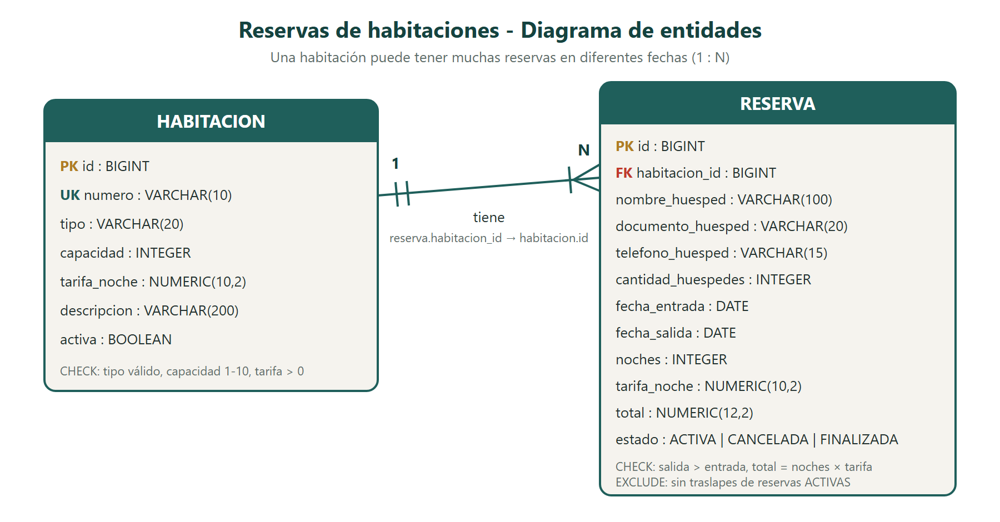
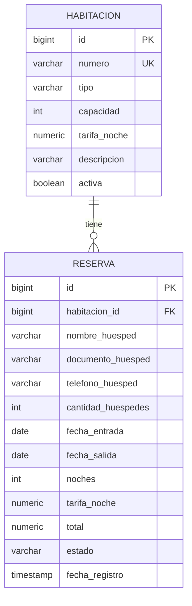

# Reservas de habitaciones — Hospedaje La Ceiba

Proyecto final · **Programación II** · Universidad Mariano Gálvez de Guatemala

| | |
|---|---|
| **Estudiante** | Emanuel de Jesus Cu Aguilar |
| **Carné** | 9941-25-18467 |
| **Código del proyecto** | PF-11 — Reservas de habitaciones |
| **Repositorio** | https://github.com/ecua-droid/reservas-hospedaje |

---

## Descripción del problema

Un hospedaje pequeño necesita registrar sus **habitaciones** y las **reservas** que hacen sus huéspedes.
El sistema debe impedir que una misma habitación se reserve para periodos que se **traslapen**, calcular
automáticamente el **total** de cada reserva según las noches y la tarifa de la habitación, y ofrecer
consultas para saber qué habitaciones están libres en unas fechas, qué reservas están activas y cuáles
pertenecen a un huésped.

## Tecnologías utilizadas

- **Java 17** (compila también con JDK 21 o 25)
- **Spring Boot 4.1.1**: Spring Web MVC, Spring Data JPA (Hibernate) y Validation
- **PostgreSQL 18** y driver JDBC de PostgreSQL
- **Maven** (incluye Maven Wrapper `mvnw`, no hace falta instalar Maven)
- **HTML, CSS y JavaScript** con Bootstrap 5.3 para el frontend
- **Postman** para las pruebas de la API
- **JUnit 5 y AssertJ** para las pruebas unitarias de las reglas de negocio

## Estructura general del sistema

```text
reservas-hospedaje/
├── database/                      Scripts SQL
│   ├── 00_crear_base_datos.sql
│   ├── 01_estructura.sql          Tablas, llaves y restricciones
│   ├── 02_datos_prueba.sql        10 habitaciones y 15 reservas
│   └── 03_consultas.sql           Consultas para evidencias
├── docs/
│   └── diagrama-entidades.png     Diagrama de entidades (también .svg)
├── evidencias/                    Documento de seguimiento (Word)
├── postman/
│   └── Reservas-Habitaciones.postman_collection.json
├── src/main/java/com/umg/hospedaje/
│   ├── controller/                Endpoints REST (reciben y responden HTTP)
│   ├── service/                   Lógica y reglas del negocio
│   ├── repository/                Acceso a datos con Spring Data JPA
│   ├── entity/                    Entidades JPA (tablas)
│   ├── dto/                       Objetos de entrada y salida de la API
│   └── exception/                 Excepciones propias y manejador global
├── src/main/resources/
│   ├── application.properties     Configuración (sin contraseñas)
│   ├── db-local.properties.example  Plantilla de la configuración local
│   └── static/                    Frontend: index.html, css/, js/
└── src/test/java/...              Pruebas unitarias de las reglas
```

**Flujo de una petición:** `Frontend / Postman → Controller → Service (reglas) → Repository → PostgreSQL`

| Capa | Responsabilidad |
|---|---|
| `controller` | Recibe la petición, valida el DTO con `@Valid` y devuelve el código HTTP. No tiene lógica de negocio. |
| `service` | Aplica las reglas del negocio, calcula totales y convierte entidades en DTO. |
| `repository` | Consultas a la base de datos (métodos derivados y `@Query` en JPQL). |
| `entity` | Clases `Habitacion` y `Reserva` mapeadas a las tablas, con su relación `@ManyToOne` / `@OneToMany`. |
| `dto` | `RequestDTO` (lo que se recibe, con validaciones) y `ResponseDTO` (lo que se devuelve). |
| `exception` | Excepciones propias y `GlobalExceptionHandler`, que responde todos los errores en formato JSON. |

## Modelo de datos





**Relación:** una habitación tiene muchas reservas (1:N). La llave foránea `reserva.habitacion_id` apunta a `habitacion.id`.

**Restricciones en PostgreSQL:** llaves primarias, llave foránea, `UNIQUE` en el número de habitación,
`CHECK` de tipo, capacidad, tarifa, fechas, total y estado, y una restricción **`EXCLUDE`** que impide en la
propia base de datos dos reservas activas traslapadas en la misma habitación.

## Reglas principales del negocio

1. **La fecha de salida debe ser posterior a la fecha de entrada.** Si no, responde `422`.
2. **No se permiten reservas activas que se traslapen para la misma habitación.** Responde `409` con la reserva con la que choca.
   - Los periodos van de la entrada a la salida **sin incluir el día de salida**: si un huésped sale el día 12, otro puede entrar ese mismo día.
   - Hay traslape cuando `entradaNueva < salidaExistente` **y** `salidaNueva > entradaExistente`.
   - Solo cuentan las reservas `ACTIVA`; las canceladas y finalizadas liberan las fechas.
3. **Total = noches × tarifa por noche de la habitación.** Lo calcula el sistema; el cliente no lo envía.

Reglas adicionales:
- La habitación debe estar activa para recibir reservas.
- La cantidad de huéspedes no puede superar la capacidad de la habitación.
- No se pueden crear reservas con fecha de entrada en el pasado.
- Solo se pueden modificar, cancelar o finalizar reservas `ACTIVA`. Una reserva se finaliza (check-out) solo si la estadía ya comenzó.
- Una habitación con reservas activas no se puede desactivar. Tampoco se puede bajar su capacidad por debajo de una reserva activa.
- El número de habitación no se puede repetir (`409`).

Las tres reglas principales están juntas en `service/ReglasReserva.java` y tienen pruebas unitarias en `ReglasReservaTest`.

## Requisitos para ejecutar el proyecto

- JDK 17 o superior (`java -version`)
- PostgreSQL 18 con pgAdmin 4
- Navegador web y Postman
- Conexión a internet la primera vez (Maven descarga las dependencias)

## Configuración de PostgreSQL

1. Abra **pgAdmin 4** y conéctese a **PostgreSQL 18**.
2. Cree la base de datos `reservas_hospedaje`: clic derecho en **Databases → Create → Database…**, o ejecute `database/00_crear_base_datos.sql`.
3. Abra el **Query Tool** sobre `reservas_hospedaje` y ejecute, en orden:
   - `database/01_estructura.sql`
   - `database/02_datos_prueba.sql`
4. Configure la contraseña **solo en su computadora**:
   - Copie `src/main/resources/db-local.properties.example` y nombre la copia `db-local.properties`, en la misma carpeta.
   - Escriba su contraseña en `spring.datasource.password=...`.
   - Ese archivo está en `.gitignore`, así que **nunca se sube a GitHub**.
   - Otra opción es definir las variables de entorno `DB_USERNAME` y `DB_PASSWORD`. `DB_URL` es opcional.

Valores por defecto: `jdbc:postgresql://localhost:5432/reservas_hospedaje`, usuario `postgres`.

> Los datos de prueba usan fechas relativas a `CURRENT_DATE`, así que siempre hay reservas pasadas, en curso y futuras.
> Para reiniciar los datos basta con volver a ejecutar `02_datos_prueba.sql`.

## Iniciar el backend

En una terminal (PowerShell) dentro de la carpeta del proyecto:

```bash
.\mvnw.cmd spring-boot:run
```

El servidor queda en **http://localhost:8080**. En IntelliJ o VS Code también se puede ejecutar la clase `ReservasHospedajeApplication`.

Para correr las pruebas unitarias:

```bash
.\mvnw.cmd test
```

## Abrir el frontend

Con el backend en ejecución, abra en el navegador **http://localhost:8080**.
Spring Boot sirve el frontend desde `src/main/resources/static`, así que no hace falta otro servidor.

El frontend permite:
- Ver indicadores: reservas activas, porcentaje de ocupación de hoy, habitaciones activas y total estimado.
- Registrar, modificar, cancelar y finalizar reservas, viendo el total estimado antes de guardar.
- Filtrar las reservas (todas, activas, por huésped o por habitación).
- Registrar, modificar, desactivar y activar habitaciones.
- Buscar habitaciones disponibles por periodo y reservar desde el resultado.
- Ver los mensajes de éxito y los errores de validación que devuelve la API, marcando los campos con error.

## Endpoints de la API

URL base: `http://localhost:8080`

### Habitaciones — `/api/habitaciones`

| Método | Ruta | Descripción | Respuesta |
|---|---|---|---|
| GET | `/api/habitaciones` | Lista todas (opcional `?activas=true`) | 200 |
| GET | `/api/habitaciones/{id}` | Consulta por ID | 200 / 404 |
| POST | `/api/habitaciones` | Registra una habitación | 201 / 400 / 409 |
| PUT | `/api/habitaciones/{id}` | Modifica una habitación | 200 / 400 / 404 / 409 / 422 |
| DELETE | `/api/habitaciones/{id}` | **Desactiva** (eliminación lógica) | 204 / 404 / 422 |
| PATCH | `/api/habitaciones/{id}/activar` | Vuelve a activar | 200 / 404 / 422 |
| GET | `/api/habitaciones/disponibles?entrada=AAAA-MM-DD&salida=AAAA-MM-DD&huespedes=2` | **Consulta:** habitaciones disponibles por periodo, con total estimado | 200 / 400 / 422 |
| GET | `/api/habitaciones/{id}/reservas` | Reservas de una habitación (relación 1:N) | 200 / 404 |

Cuerpo para POST y PUT:

```json
{
  "numero": "105",
  "tipo": "DOBLE",
  "capacidad": 2,
  "tarifaNoche": 350.00,
  "descripcion": "Cama matrimonial"
}
```

`tipo` admite: `SENCILLA`, `DOBLE`, `TRIPLE` o `SUITE`.

### Reservas — `/api/reservas`

| Método | Ruta | Descripción | Respuesta |
|---|---|---|---|
| GET | `/api/reservas` | Lista todas | 200 |
| GET | `/api/reservas/{id}` | Consulta por ID | 200 / 404 |
| POST | `/api/reservas` | **Operación de negocio:** registra la reserva aplicando las reglas | 201 / 400 / 404 / 409 / 422 |
| PUT | `/api/reservas/{id}` | Modifica una reserva activa y recalcula el total | 200 / 400 / 404 / 409 / 422 |
| PATCH | `/api/reservas/{id}/cancelar` | Cancela una reserva (libera las fechas) | 200 / 404 / 422 |
| PATCH | `/api/reservas/{id}/finalizar` | Finaliza la reserva (check-out) | 200 / 404 / 422 |
| GET | `/api/reservas/activas` | **Consulta:** reservas activas | 200 |
| GET | `/api/reservas/huesped?texto=Ana` | **Consulta:** reservas por huésped (nombre o documento) | 200 / 400 |
| GET | `/api/reservas/{id}/total` | **Indicador:** total estimado de una reserva (noches × tarifa) | 200 / 404 |
| GET | `/api/reservas/cotizar?habitacionId=3&entrada=...&salida=...` | Total estimado y disponibilidad **antes** de reservar | 200 / 400 / 404 / 422 |
| GET | `/api/reservas/resumen` | **Indicador:** ocupación de hoy, conteo por estado y total estimado de las activas | 200 |

Cuerpo para POST y PUT:

```json
{
  "habitacionId": 3,
  "nombreHuesped": "Ana Lucía Pérez",
  "documentoHuesped": "DPI-100001",
  "telefonoHuesped": "5550-1001",
  "cantidadHuespedes": 2,
  "fechaEntrada": "2026-12-10",
  "fechaSalida": "2026-12-13"
}
```

`noches`, `tarifaNoche`, `total` y `estado` los calcula el sistema.

### Formato de los errores

Todas las respuestas de error tienen la misma forma:

```json
{
  "fecha": "2026-11-06T10:15:30",
  "estado": 409,
  "error": "Fechas no disponibles",
  "mensaje": "La habitación 103 ya tiene la reserva activa #5 del 04/11/2026 al 08/11/2026. Elija otras fechas u otra habitación.",
  "ruta": "/api/reservas",
  "errores": {}
}
```

| Código | Cuándo ocurre |
|---|---|
| 400 | Datos inválidos (`@Valid`), JSON mal formado, fecha o ID con formato incorrecto, parámetro faltante |
| 404 | Habitación o reserva inexistente, relación con una habitación inexistente, ruta inexistente |
| 405 | Método HTTP no permitido en la ruta |
| 409 | Número de habitación duplicado, reserva traslapada, restricción de la base de datos |
| 422 | Regla de negocio incumplida: fechas, capacidad, estado, habitación inactiva |
| 500 | Error inesperado del servidor |

## Pruebas con Postman

1. En Postman, importe `postman/Reservas-Habitaciones.postman_collection.json` con **Import**.
2. Con el backend en ejecución y los datos de prueba cargados, ejecute la colección con **Run collection**.
3. La colección tiene 37 solicitudes en 4 carpetas: Habitaciones, Reservas, Consultas e indicadores, y Validaciones, excepciones y reglas.
4. Cada solicitud verifica automáticamente el código HTTP esperado.
5. Las fechas se calculan a partir del día de hoy.

## Datos de prueba

- **10 habitaciones** (101–302). La 302 está desactivada.
- **15 reservas**:
  - 3 finalizadas
  - 3 canceladas
  - 9 activas: 3 en curso hoy y 6 futuras
- Todos los nombres, documentos y teléfonos son **ficticios**.
